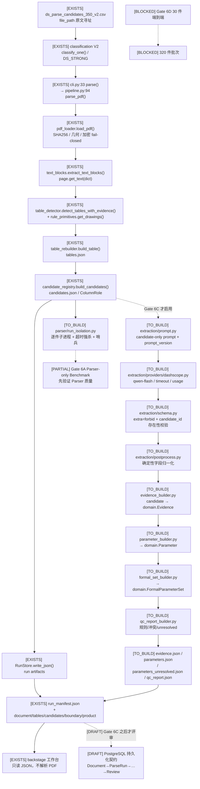

# 目标调用链图（Gate 6C 目标态 · 暂缓）

**状态：暂缓草案。** 按 Reviewer 最新路线，Gate 6C（LLM 接入）暂缓，
本图只是「Parser 基线验证通过后」的目标态，供复核字段与证据边界，
**不代表已实现、已接线或已批准**。图中 `TO_BUILD` 节点本轮一行代码都未写。

图例：`[EXISTS]` 权威仓库现有可调用代码 · `[PARTIAL]` 现有但缺关键环节 ·
`[TO_BUILD]` 待建 · `[DRAFT]` 仅契约草案 · `[BLOCKED]` 未批准。

---

## 一、Mermaid 调用链



---

## 二、纯文本调用链（便于文本审阅）

```
[Gate 6A：当前应做的事 — Parser only，无 LLM，无 DB]
  候选清单 file_path 原文
    → cli.parse() → pipeline.parse_pdf()
        → pdf_loader.load_pdf()          [SHA256 / page.rect / 加密拒绝]
        → text_blocks.extract_text_blocks()   [span/word + bbox]
        → table_detector.detect_tables_with_evidence()
            → rule_primitives.get_drawings() [矢量规则线]
        → page_renderer.render_page()        [PNG，仅检测到表格的页]
        → table_rebuilder.build_table()      → tables.json
        → candidate_registry.build_candidates()
                                          → candidates.json (ColumnRole)
        → RunStore.write_json()              → 9 个 run artifacts
    → [TO_BUILD] run_isolation.py            [整件子进程，崩溃不扩散]
    → Gate 6A 评估脚本                       → per_item_metrics.csv / metrics.json

[Gate 6C：暂缓 — 只有 Parser 基线通过后才启用]
  candidates.json
    → prompt.py (candidate-only，禁止发明数值/candidate_id)
    → providers/dashscope.py (真实 qwen-flash)
    → schema.py (extra=forbid，candidate_id 必须存在于 CandidateSet)
    → postprocess.py (确定性归一化；单位/范围/符号原样保留)
    → evidence_builder.py → domain.Evidence
    → parameter_builder.py → domain.Parameter
    → formal_set_builder.py → domain.FormalParameterSet
    → qc_report_builder.py
    → evidence.json / parameters.json / parameters_unresolved.json / qc_report.json

[Storage 现状]
  RunStore + artifact_store.py：只写 runs/<run_id>/，runs/ 被 .gitignore:18 忽略
  无数据库连接、无 DSN、无 ORM、无 INSERT；backstage 工作台只读 JSON
  [DRAFT] PostgreSQL 契约见 POSTGRES_MODEL_DRAFT.md —— 不建库、不执行
```

---

## 三、逐节点证据与状态

| 节点 | 状态 | 真实路径 / 函数 | 说明 |
| --- | --- | --- | --- |
| 输入寻址 | EXISTS | `runs/stage_a_350/ds_parse_candidates_350_v2.csv` | 必须用 `file_path` 原文，禁止按 SHA 找路径（P2 `G1-P2-001`） |
| 分类准入 | EXISTS | `src/icpdf/classification/classifier.py::classify_one()` | V2 纯规则，无 LLM |
| 解析入口 | EXISTS | `src/icpdf/cli.py:33 parse()` → `src/icpdf/parser/pipeline.py:94 parse_pdf()` | 确定性链，无 LLM |
| PDF 处理 | EXISTS | `pdf_loader.py:41` / `text_blocks.py:52` / `table_detector.py:160` / `table_rebuilder.py` / `candidate_registry.py:42` | 主进程持有 fitz Page（P1-001） |
| 子进程保护 | TO_BUILD | 拟 `parser/run_isolation.py` + `_parse_worker.py` | 见 `P1_FIX_DESIGN.md` 方案 A |
| **LLM Provider** | **TO_BUILD（Gate 6C 暂缓）** | 拟 `extraction/providers/dashscope.py` | 现状：`extraction/providers/__init__.py` 是 Phase 2 空占位 |
| **Prompt** | **TO_BUILD（暂缓）** | 拟 `extraction/prompt.py` | 现状：`pipeline.py:187` 写 `prompt_version=""` |
| **输出 Schema** | **PARTIAL** | `src/icpdf/domain/*` 已有严格 Pydantic 模型 | 但没有「模型响应 → Schema」链；`cli.py:80 extract` 仍占位 |
| **Evidence** | **TO_BUILD（暂缓）** | 拟 `extraction/evidence_builder.py` | `domain.Evidence` 在生产链零实例化；工作台期望 `evidence.json` |
| **Domain** | **PARTIAL** | `domain/{document,product,parameter,evidence,candidate,table}.py` | 模型完备，但 `Parameter`/`FormalParameterSet` 未产出 |
| **Storage** | **EXISTS（文件）/ MISSING（DB）** | `storage/run_store.py::RunStore` + `artifact_store.py` | 只写 run artifacts；无数据库 |
| 下游读取 | EXISTS（只读） | `backstage/*.html` + `backstage/…修订版.md:5` | 工作台明确「不替代解析器」 |
| **PostgreSQL** | **DRAFT（不执行）** | `POSTGRES_MODEL_DRAFT.md` | 仅逻辑契约，不写 DDL、不建库 |

### 三个必须保持的边界

1. **不建平行解析器**：LLM 节点只消费 `candidates.json` 中已存在的
   `candidate_id`，不重新读 PDF、不重新抽文本。
2. **原始响应与正式参数分离**：LLM 原始响应、规范化参数、Evidence、人工审核
   分别保存，不把临时 JSON 结构固化为长期结构（见 `POSTGRES_MODEL_DRAFT.md`）。
3. **顺序不可颠倒**：Gate 6A 未确认 Parser 基线前，图中虚线右侧的
   Gate 6C/6D 节点一律不启用；`ICPDF_EXTRACTOR_LLM_READY` 保持 `false`。
